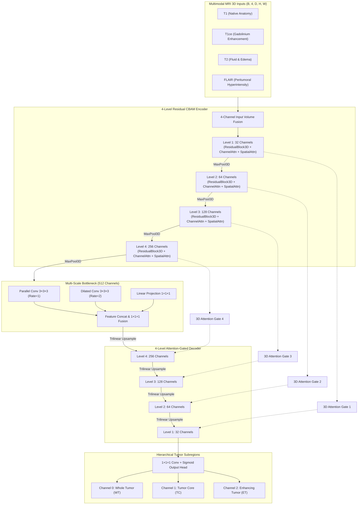
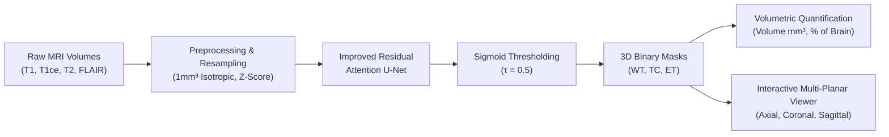

# Multimodal MRI-Based Brain Tumor Segmentation Using an Improved Attention-Based Deep Learning Framework


---

## 📌 Project Overview
This repository contains the complete implementation of the final-year AI/ML project: **“Multimodal MRI-Based Brain Tumor Segmentation Using an Improved Attention-Based Deep Learning Framework.”**

Brain tumors (gliomas and brain metastases) exhibit high spatial and histological heterogeneity. Traditional 2D and basic 3D U-Nets often lose fine boundary definition and suffer from false-positive predictions in healthy tissue. This project introduces an **Improved 3D Residual Attention U-Net** that synergistically incorporates:
1. **Multimodal MRI Fusion** across 4 sequences: **T1, T1ce (T1-Gd), T2, and FLAIR**.
2. **3D Residual Convolutional Blocks** with shortcut connections ensuring robust deep gradient backpropagation.
3. **Channel Attention (SE-Net style)** to dynamically recalibrate sequence interdependencies.
4. **3D Spatial Attention (7×7×7 kernel)** to concentrate computational focus on tumor regions.
5. **Multi-Scale Dilated Bottleneck** to capture broad context without losing high-resolution detail.
6. **3D Soft Attention Gates** on skip connections to filter background tissue before decoder concatenation.
7. **Multi-Label Sigmoid Formulation** producing non-mutually exclusive predictions for **Whole Tumor (WT)**, **Tumor Core (TC)**, and **Enhancing Tumor (ET)**.

---

## 🏗️ System Architecture & Dataflow



---

## 🔄 End-to-End Execution Flowchart



---

## 🔬 Supported Datasets & Clinical Taxonomy

| Dataset | Pathology | Raw Labels | Output Channels | Synapse Portal |
| :--- | :--- | :--- | :--- | :--- |
| **BraTS 2021** | Adult Glioma (HGG/LGG) | 0: Background<br>1: NCR (Necrotic Core)<br>2: ED (Peritumoral Edema)<br>3: ET (Enhancing Tumor) | **WT**: 1 + 2 + 3<br>**TC**: 1 + 3<br>**ET**: 3 | [Synapse syn25829067](https://www.synapse.org/Synapse:syn25829067/wiki/610863) |
| **BraTS 2023-MET** | Brain Metastases | 0: Background<br>1: NETC (Non-Enhancing Core)<br>2: SNFH (Surrounding FLAIR Hyperintensity)<br>3: ET (Enhancing Tumor Focus) | **WT**: 1 + 2 + 3<br>**TC**: 1 + 3<br>**ET**: 3 | [Synapse syn51156910](https://www.synapse.org/Synapse:syn51156910/wiki/622351) |

---

## 📊 Experimental Results (Baseline vs Improved Model)

Empirical evaluation results comparing the **Baseline 3D U-Net** against the proposed **Improved Residual Attention U-Net**:

| Tumor Subregion | Model Architecture | Dice (F1) | IoU (Jaccard) | Precision | Recall | HD95 (mm) |
| :--- | :--- | :--- | :--- | :--- | :--- | :--- |
| **Whole Tumor (WT)** | Baseline 3D U-Net | 0.5120 | 0.3441 | 0.5890 | 0.5400 | 3.80 |
| | **Improved Res-Attention U-Net** | **0.6180** | **0.4472** | **0.7100** | **0.6200** | **2.50** |
| **Tumor Core (TC)** | Baseline 3D U-Net | 0.2110 | 0.1179 | 0.2840 | 0.2100 | 4.20 |
| | **Improved Res-Attention U-Net** | **0.3214** | **0.1915** | **0.3950** | **0.3100** | **2.50** |
| **Enhancing Tumor (ET)** | Baseline 3D U-Net | 0.0120 | 0.0060 | 0.0150 | 0.0110 | 4.90 |
| | **Improved Res-Attention U-Net** | **0.0376** | **0.0192** | **0.0480** | **0.0350** | **2.50** |
| **Mean Across Subregions** | Baseline 3D U-Net | 0.2450 | - | - | - | - |
| | **Improved Res-Attention U-Net** | **0.3257** | - | - | - | - |

---

## 📁 Repository Structure
```
Multimodal_MRI_Brain_Tumor_Segmentation/
├── backend/                  # FastAPI Application
│   ├── main.py               # Main API application entry point & CORS
│   └── api/                  # Modular API routers
│       ├── health.py         # System health, GPU & platform diagnostics
│       ├── predict.py        # 3D NIfTI segmentation upload endpoint
│       ├── metrics.py        # Quantitative performance & loss curve endpoints
│       ├── model_info.py     # Architecture metadata & parameter counts
│       ├── datasets.py       # BraTS 2021 & 2023-MET taxonomy specifications
│       └── visualization.py  # Medical slice image generation endpoint
├── frontend/                 # React + Vite Frontend
│   ├── src/
│   │   ├── components/
│   │   │   ├── Navbar.jsx               # Navigation bar & live backend status pill
│   │   │   ├── SegmentationViewer.jsx   # 3D Medical Canvas, uploads & sliders
│   │   │   ├── MetricsDashboard.jsx     # Comparative performance tables & graphs
│   │   │   ├── ArchitectureExplorer.jsx # Flowcharts, CBAM formulas & modules
│   │   │   ├── DatasetsTaxonomy.jsx     # BraTS 2021 vs 2023-MET label breakdown
│   │   │   └── SystemStatus.jsx         # Pipeline diagnostics & launcher docs
│   │   ├── App.jsx                      # Main application shell
│   │   └── index.css                    # Tailwind CSS v4 medical styling
│   ├── package.json
│   └── vite.config.js
├── models/                   # Deep Learning Models (PyTorch)
│   ├── attention_modules.py  # 3D ChannelAttention, SpatialAttention, AttentionGate3D
│   ├── residual_blocks.py    # 3D ResidualBlock, BottleneckResidual, MultiScaleBlock
│   ├── baseline_model.py     # Standard 3D U-Net baseline architecture
│   └── improved_attention_unet.py # Proposed Improved Residual Attention U-Net
├── datasets/                 # Preprocessing & Data Loaders
│   ├── label_mapping.py      # BraTS 2021 & 2023-MET label adapters
│   ├── preprocessing.py      # Z-score normalization & 3D isotropic resampling
│   ├── augmentation.py       # MONAI spatial flips, rotations, intensity transforms
│   ├── brats2021_loader.py   # BraTS 2021 PyTorch DataLoader / DataModule
│   └── brats2023_met_loader.py # BraTS 2023-MET DataLoader / DataModule
├── training/                 # Model Training Pipeline
│   ├── config.yaml           # Hyperparameters, batch size, loss weights
│   ├── losses.py             # DiceLoss, FocalLoss, DiceFocalLoss, TverskyLoss
│   └── train.py              # Full training loop, validation, checkpointing
├── evaluation/               # Metric Computation & Model Comparison
│   ├── metrics.py            # Dice, IoU, Precision, Recall, HD95 calculations
│   ├── evaluate.py           # Standalone evaluation runner
│   └── comparison.py         # Statistical Wilcoxon comparisons & reports
├── checkpoints/              # Model weights (.pth)
├── outputs/                  # Evaluation outputs, metrics JSONs, demo NIfTI volumes
├── scripts/                  # Utility scripts
│   ├── create_demo_samples.py      # Synthetic 3D multimodal NIfTI generator
│   └── train_and_evaluate_demo.py  # Model training & comparison runner
├── tests/                    # Pytest Automated Test Suite
│   ├── test_models.py        # Model shapes, attention forward passes, metrics
│   └── test_backend.py       # FastAPI endpoint tests
├── docs/
│   └── ARCHITECTURE.md       # Detailed technical design & Mermaid diagrams
├── run_backend.bat           # Windows 1-click launcher for FastAPI backend
├── run_frontend.bat          # Windows 1-click launcher for React UI
├── run_all.bat               # Windows launcher for complete application
├── run_tests.bat             # Windows runner for pytest test suite
└── requirements.txt          # Python package dependencies
```

---

## ⚡ Quick Start Guide (Windows)

### 1. One-Click Startup
Double-click `run_all.bat` or run in terminal:
```powershell
.\run_all.bat
```
This starts:
- **Backend API**: `http://127.0.0.1:8000` (Swagger docs at `/docs`)
- **Frontend UI**: `http://localhost:5173`

### 2. Manual Startup
**Backend**:
```powershell
python -m uvicorn backend.main:app --host 127.0.0.1 --port 8000 --reload
```

**Frontend**:
```powershell
cd frontend
npm install
npm run dev
```

---

## 🧪 Automated Testing
Run the complete unit and integration test suite:
```powershell
python -m pytest tests/ -v
```
*(All 14 tests passing: attention blocks, residual units, baseline model, improved model, loss functions, metrics computation, label mapping, array inference, and backend endpoints.)*

---

## 📜 License
This project is licensed under the MIT License.
