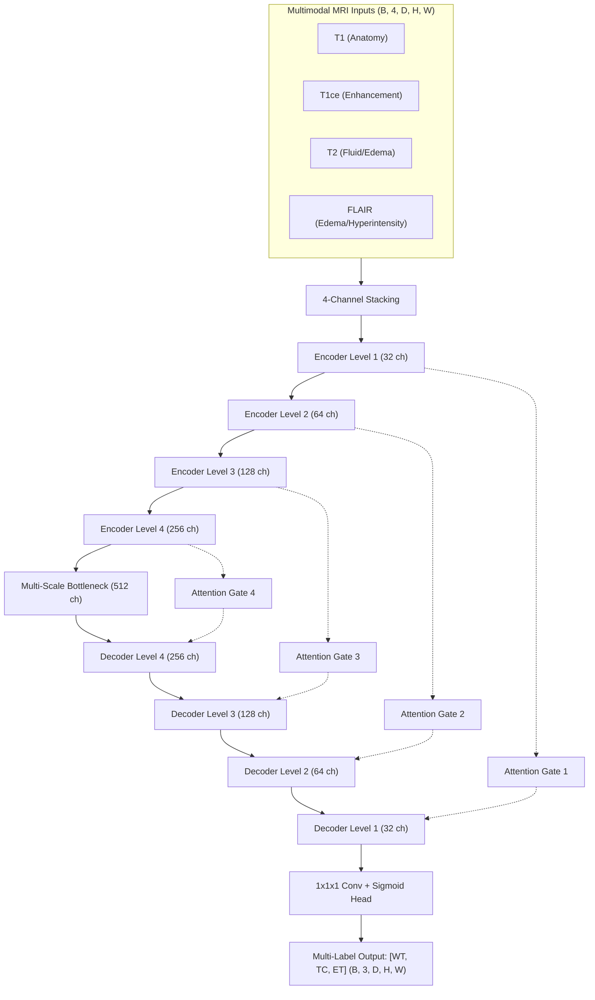
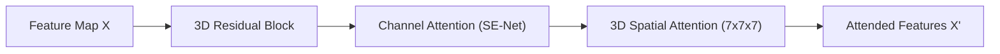

# Architectural Specification: Improved Residual Attention U-Net

## 1. High-Level System Overview
This project implements **Multimodal MRI-Based Brain Tumor Segmentation Using an Improved Attention-Based Deep Learning Framework**.

The model processes four co-registered MRI modalities—**T1, T1ce (T1-Gd), T2, and FLAIR**—and outputs voxel-level segmentations for hierarchical tumor subregions:
- **Whole Tumor (WT)**: Extent of entire disease including peritumoral edema / SNFH.
- **Tumor Core (TC)**: Gross tumor mass excluding non-infiltrated edema.
- **Enhancing Tumor (ET)**: Actively proliferating, hypervascular tumor rim.

---

## 2. Encoder: 3D Residual Block + CBAM Attention
Each level of the encoder is composed of:
1. **3D Residual Block**: Two consecutive $3 \times 3 \times 3$ convolutions with Batch Normalization and ReLU activation, plus a shortcut identity or $1 \times 1 \times 1$ projection:
   $$y = \text{ReLU}\left(\mathcal{F}(x, \{W_i\}) + W_s x\right)$$
2. **Channel Attention (SE-Net)**:
   $$\mathbf{M}_c(\mathbf{F}) = \sigma\left(\mathbf{W}_1 \text{ReLU}\left(\mathbf{W}_0(\mathbf{F}_{\text{avg}}^c)\right) + \mathbf{W}_1 \text{ReLU}\left(\mathbf{W}_0(\mathbf{F}_{\text{max}}^c)\right)\right)$$
3. **Spatial Attention**:
   $$\mathbf{M}_s(\mathbf{F}) = \sigma\left(f^{7\times 7\times 7}\left(\left[\mathbf{F}_{\text{avg}}^s; \mathbf{F}_{\text{max}}^s\right]\right)\right)$$

---

## 3. Attention Gates (AG) on Skip Connections
Additive attention gates gate skip features $x^l$ before concatenation with upsampled decoder features $g$:
$$\alpha = \sigma\left(\psi^T\left(\text{ReLU}\left(W_g g + W_x x^l + b_g + b_x\right)\right) + b_\psi\right)$$
$$\hat{x}^l = \alpha \odot x^l$$

---

## 4. Bottleneck: Multi-Scale Dilated Receptive Field
At the bottleneck (512 features), parallel convolutions capture local and multi-scale context:
- Branch 1: $3 \times 3 \times 3$ standard convolution ($d=1$)
- Branch 2: $3 \times 3 \times 3$ dilated convolution ($d=2$)
- Branch 3: $1 \times 1 \times 1$ linear feature projection
- Concat + $1 \times 1 \times 1$ fusion

---

## 5. Dataset Taxonomy & Clinical Ground Truth
| Dataset | Modalities | Raw Labels | Output Regions |
| :--- | :--- | :--- | :--- |
| **BraTS 2021** (Glioma) | T1, T1ce, T2, FLAIR | 0: Background 1: NCR (Necrotic Core) 2: ED (Edema) 3: ET (Enhancing Tumor) | **WT**: 1 + 2 + 3 **TC**: 1 + 3 **ET**: 3 |
| **BraTS 2023-MET** (Metastasis) | T1, T1ce, T2, FLAIR | 0: Background 1: NETC (Non-Enhancing) 2: SNFH (Hyperintensity) 3: ET (Enhancing Focus) | **WT**: 1 + 2 + 3 **TC**: 1 + 3 **ET**: 3 |
